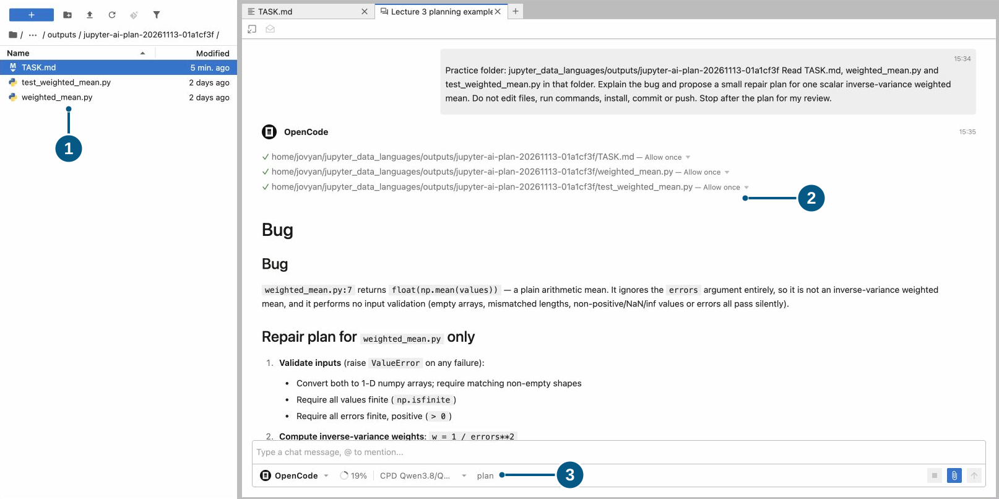
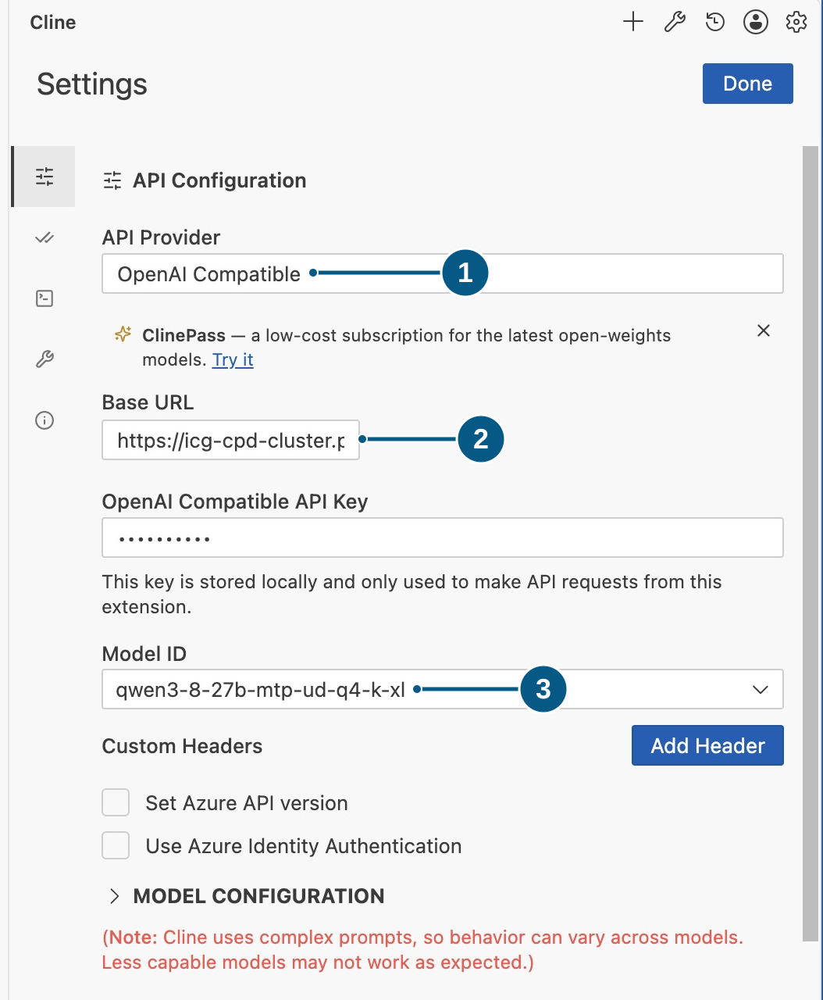

# Choose your coding agent

Prepare **one** graphical route before Session 3; pairs may share or follow the
manual pair route. **Jupyter AI on CPD** is the recommended zero-install default.
Complete sign-in and setup **before class**. Use the graphical app or panel for
every agent prompt; keep the terminal for setup, `pytest` and Git.

## Prepare the practice workspace

In a CPD JupyterLab **Terminal**, activate the course environment:

```bash
source /opt/course/.venv/bin/activate
```

Locally, activate your course environment instead. From the **course root**, run:

```bash
python scripts/create_agent_practice.py outputs/agent-practice
```

This creates `TASK.md` (recording your active course Python interpreter path),
`weighted_mean.py` and `test_weighted_mean.py`, commits the failing starter on
`main`, and switches to `agent-repair` with no remote. It refuses existing
paths—use a new folder name to repeat. Open the printed folder in your agent
(CPD and laptop checkouts do not share files).

## Controls for your tool

`````{tab-set}
````{tab-item} Jupyter AI on CPD
:sync: agent-jupyterai

**Recommended zero-install default** — browser UI, **OpenCode** and **Qwen 3.8
27B** (`cpd/qwen3.8`) all hosted on CPD.

- **Setup:** Open **Jupyter Chat → New chat**, select **OpenCode** (confirm
  `cpd/qwen3.8` under **More controls**), and attach or give server-relative
  paths to `TASK.md`, `weighted_mean.py` and `test_weighted_mean.py`.
- **Controls:** Start in **plan** mode; choose **Allow once** or **Reject** on
  tool prompts; inspect diffs in tool cards and JupyterLab **Git**; click **Stop
  generating** to interrupt ([docs](https://jupyter-ai.readthedocs.io/en/latest/users/chat/index.html)).



**Hosted CPD setup:** **1** names the practice files, **2** shows scoped reads and the plan, and **3** confirms OpenCode, CPD Qwen and plan mode ([full-size image](../book/screenshots/jupyter-ai-plan.svg)).
````

````{tab-item} Cline + CPD Qwen
:sync: agent-cline

**Free local VS Code route** — local file/shell tools on your laptop paired with
remote Qwen on CPD.

- **Setup:** Open `outputs/agent-practice` in VS Code and set **Cline** to
  **OpenAI Compatible** (distinct from `cpd/qwen3.8`):

| Setting | Course value |
| --- | --- |
| Base URL | `https://icg-cpd-cluster.port.ac.uk/v1` |
| Model ID | `qwen3-8-27b-mtp-ud-q4-k-xl` |
| Access | Instructor's setting; keep credentials out of prompts |

- **Controls:** Start in **Plan**, switch to **Act** after review, and keep
  **Auto-approve: None** (YOLO off). Inspect diffs before **Save**/**Reject**,
  review in Source Control or checkpoints, and click **Cancel** to stop
  ([provider](https://docs.cline.bot/provider-config/openai-compatible) ·
  [Plan/Act](https://docs.cline.bot/core-workflows/plan-and-act) ·
  [approvals](https://docs.cline.bot/features/auto-approve)).



**Cline CPD settings:** **1** selects OpenAI Compatible, **2** sets the Base URL and masked key, and **3** selects `qwen3-8-27b-mtp-ud-q4-k-xl` ([full-size image](../book/screenshots/cline-cpd-settings.svg)).
````

````{tab-item} Claude Code
:sync: agent-claude

**Commercial editor/desktop route** — local tools with your pre-configured
commercial cloud account.

- **Setup:** Open `outputs/agent-practice` in VS Code's **Claude Code** panel
  (or Claude Desktop's **Code** tab).
- **Controls:** Select **Plan** for inspection (**No, keep planning** if asked
  to exit early), then **Manual** for edits. Read each diff or command before
  one-time **Yes** (**No** to narrow scope), inspect Source Control diffs, and
  click **Stop** to interrupt ([VS Code guide](https://code.claude.com/docs/en/vs-code)).


**Claude Code controls:** **1** checks the hand-derived example, **2** lists input validation, and **3** confirms Plan mode remained active ([full-size image](../book/screenshots/claude-editor-plan.svg)).
````
`````

## Using another graphical agent?

| Tool | Where tools run | Plan control | Controlled edit / approval | Diff review | Docs |
| --- | --- | --- | --- | --- | --- |
| **Codex** (VS Code/Desktop) | Local (`Work locally`) | Inspection prompt | **Ask for approval** (**Stop** if workspace edits exceed scope) | Review pane / Source Control | [IDE](https://learn.chatgpt.com/docs/codex/ide), [Review](https://learn.chatgpt.com/docs/code-review) |
| **Antigravity** (Desktop) | Local (**This Computer**) | `/plan` action | **Request Review** preset (**Cancel** to stop) | **Overview → Review** | [Setup](https://antigravity.google/docs/getting-started), [Permissions](https://antigravity.google/docs/agent-settings) |
| **OpenCode Desktop** | Local folder | **Choose agent → Plan** | **Build**, auto-accept off; **Allow once** / **Deny** (**Stop**) | **Toggle review** & `git diff` | [Desktop](https://dev.opencode.ai/desktop), [Permissions](https://opencode.ai/docs/permissions) |
