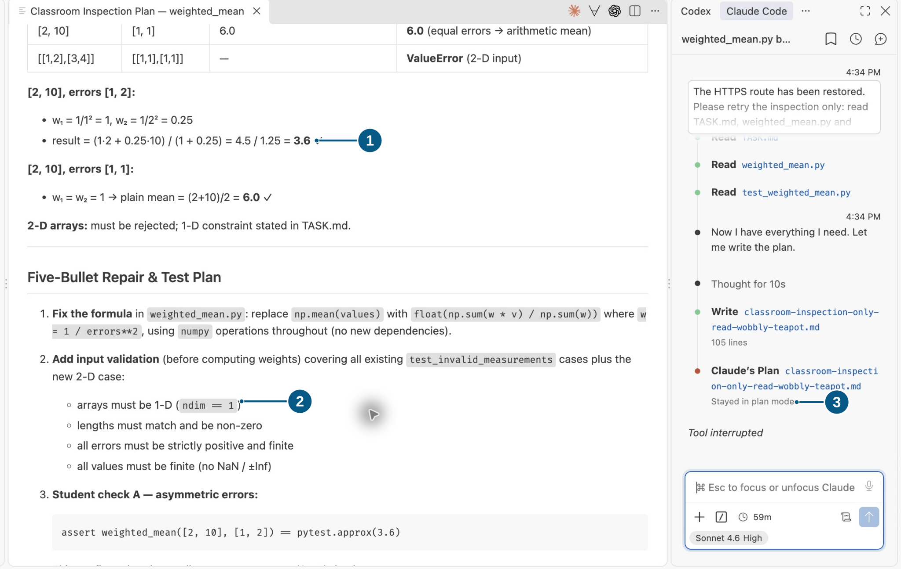
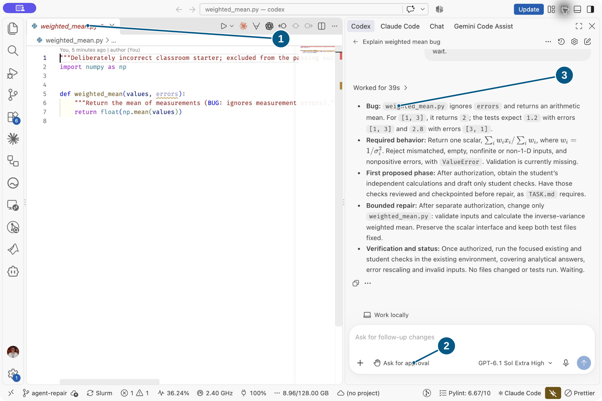
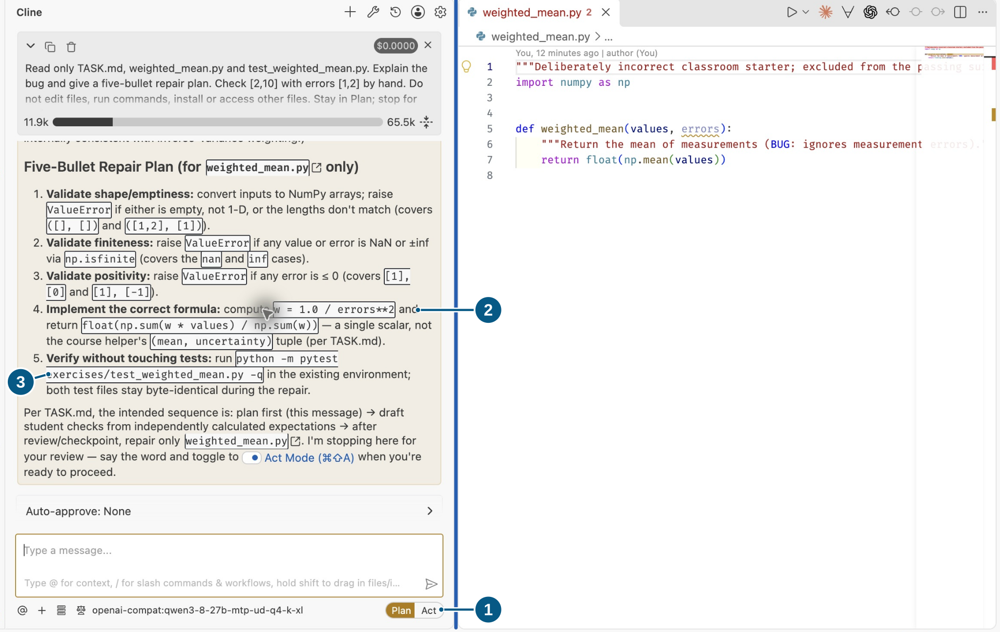

# Choose your coding agent

Prepare **one** graphical route before Session 3, or follow the manual route
without an agent. Complete sign-in or model configuration and workspace setup
before starting Session 3. Use the graphical app or panel for every agent
prompt; keep the terminal for setup, `pytest` and Git.

## Prepare the practice workspace

From the **course root**, activate your course environment (`source .venv/bin/activate`
on macOS/Linux, `source .venv/Scripts/activate` in Windows Git Bash, or
`conda activate python-phd`), then run:

```bash
python scripts/create_agent_practice.py outputs/agent-practice
```

This creates `TASK.md` (recording your active course Python interpreter path),
`weighted_mean.py` and `test_weighted_mean.py`, commits the failing starter on
`main`, and switches to `agent-repair` with no remote. It refuses existing
paths—use a new folder name to repeat. Open the printed `outputs/agent-practice`
folder in your agent.

## Controls for your tool

`````{tab-set}
````{tab-item} Claude Code
:sync: agent-claude

**VS Code extension or Claude Desktop (`Code` tab)** — local workspace tools
paired with your configured Claude account.

- **Setup:** Open `outputs/agent-practice` in VS Code's **Claude Code** panel
  (or Claude Desktop's **Code** tab).
- **Controls:** Select **Plan** for inspection (**No, keep planning** if asked
  to exit early), then **Manual** for edits. Read each diff or command before
  one-time **Yes** (**No** to narrow scope), inspect Source Control diffs, and
  click **Stop** to interrupt ([VS Code guide](https://code.claude.com/docs/en/vs-code)).



**Claude Code controls:** **1** checks the hand-derived example, **2** lists input validation, and **3** confirms Plan mode remained active ([full-size image](../book/screenshots/claude-editor-plan.svg)).
````

````{tab-item} Codex
:sync: agent-codex

**VS Code extension or Codex Desktop** — local workspace tools paired with your
configured Codex account.

- **Setup:** Open `outputs/agent-practice` in VS Code's **Codex** panel (or
  Codex Desktop) with **Work locally** selected.
- **Controls:** Send a read-only inspection prompt before allowing edits, keep
  the **Ask for approval** preset active (noting workspace actions can still run
  automatically unless explicitly scoped in your prompt), inspect diffs in the
  Review pane or Source Control, and click **Stop** if edits exceed scope
  ([Codex IDE docs](https://learn.chatgpt.com/docs/codex/ide) ·
  [Code review](https://learn.chatgpt.com/docs/codex/code-review)).



**Codex controls:** **1** checks the active practice file and local project, **2** confirms `Work locally` and `Ask for approval` (noting workspace actions can still run automatically unless scoped), and **3** reviews the proposed scientific contract and phase boundaries ([full-size image](../book/screenshots/codex-editor-plan.svg)).
````

````{tab-item} Cline
:sync: agent-cline

**Open-source VS Code extension** — local workspace tools paired with any
OpenAI-compatible API, institutional endpoint, OpenRouter, or local model server
(`Ollama` at `http://localhost:11434/v1` or `llama.cpp` at `http://localhost:8080/v1`).

- **Setup:** Open `outputs/agent-practice` in VS Code and configure **Cline**:

| Setting | Recommended value |
| --- | --- |
| API Provider | `OpenAI Compatible` or `Ollama` |
| Base URL | e.g. `http://localhost:11434/v1`, `http://localhost:8080/v1`, or provider `/v1` endpoint |
| Model ID | Your chosen coding model |
| Credentials | Keep API keys masked and out of prompts and Git |

- **Controls:** Start in **Plan**, switch to **Act** after review, and keep
  **Auto-approve: None** (YOLO off). Inspect diffs before **Save**/**Reject**,
  review in Source Control or checkpoints, and click **Cancel** to stop
  ([provider](https://docs.cline.bot/provider-config/openai-compatible) ·
  [Plan/Act](https://docs.cline.bot/core-workflows/plan-and-act) ·
  [approvals](https://docs.cline.bot/features/auto-approve)).



**Cline controls:** **1** confirms Plan mode with Auto-approve: None, **2** checks the inverse-variance formula, and **3** catches an out-of-scope test path before approval ([full-size image](../book/screenshots/cline-editor-plan.svg)).
````
`````

## Using another graphical agent?

| Tool | Where tools run | Plan control | Controlled edit / approval | Diff review | Docs |
| --- | --- | --- | --- | --- | --- |
| **Antigravity** (Desktop) | Local (**This Computer**) | `/plan` action | **Request Review** preset (**Cancel** to stop) | **Overview → Review** | [Setup](https://antigravity.google/docs/getting-started), [Permissions](https://antigravity.google/docs/agent-settings) |
| **OpenCode Desktop** | Local folder | **Choose agent → Plan** | **Build**, auto-accept off; **Allow once** / **Deny** (**Stop**) | **Toggle review** & `git diff` | [Desktop](https://dev.opencode.ai/desktop), [Permissions](https://opencode.ai/docs/permissions) |
| **Jupyter AI** (JupyterLab) | JupyterLab host | **OpenCode** / chat in **plan** mode | **build** mode; **Allow once** / **Reject** (**Stop generating**) | Tool cards & JupyterLab **Git** | [Chat docs](https://jupyter-ai.readthedocs.io/en/latest/users/chat/index.html) |
