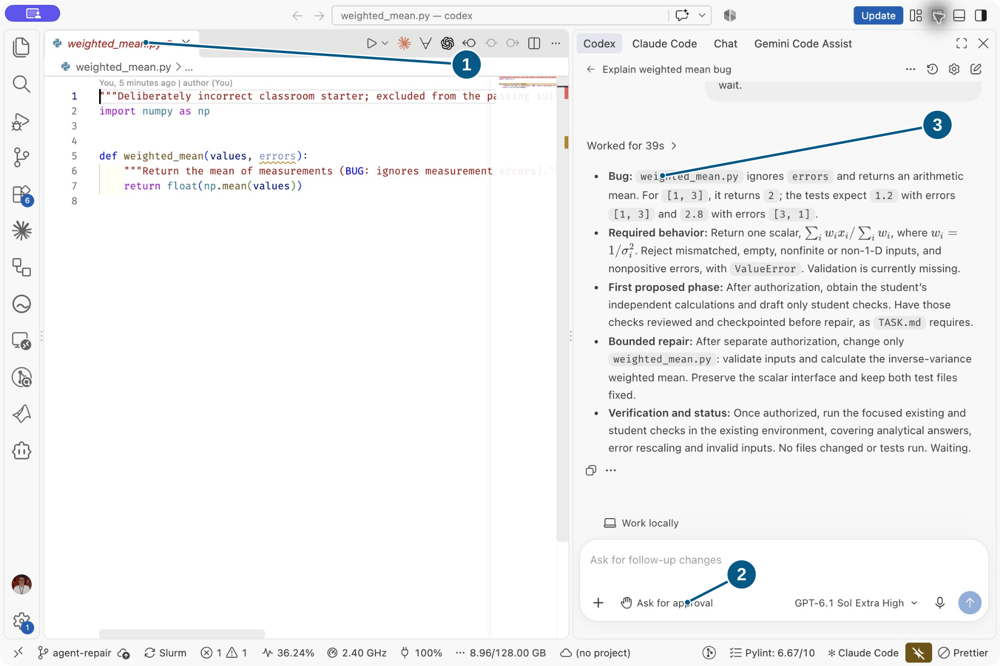
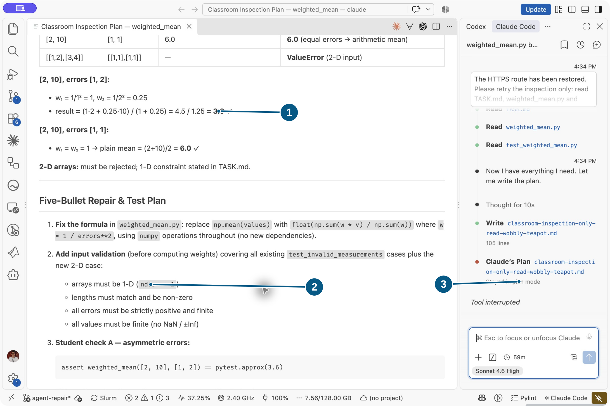
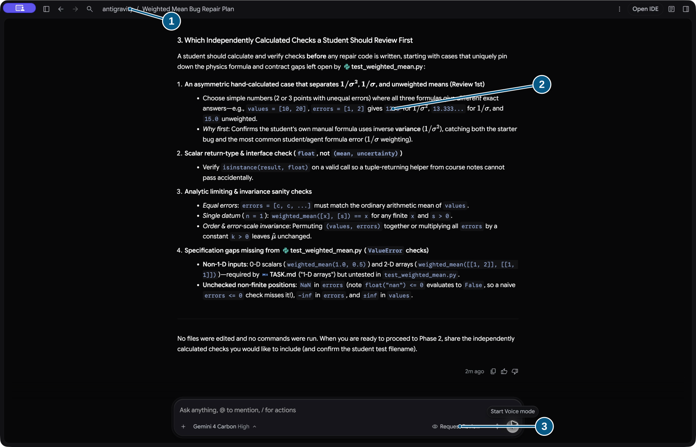
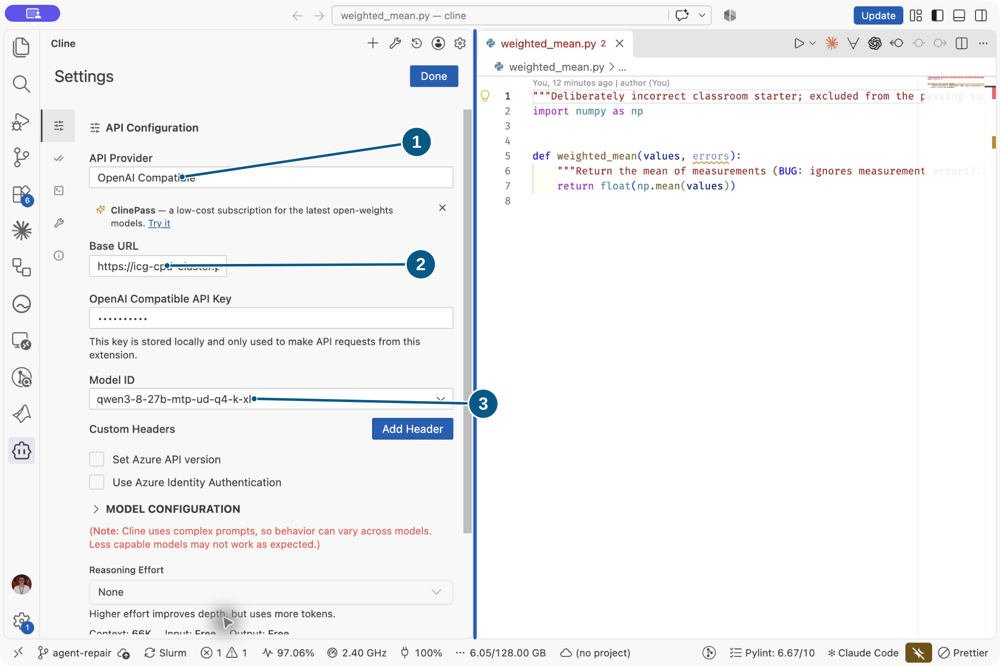
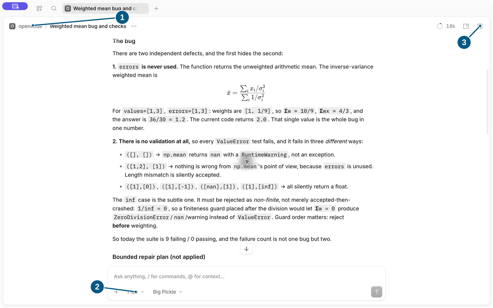
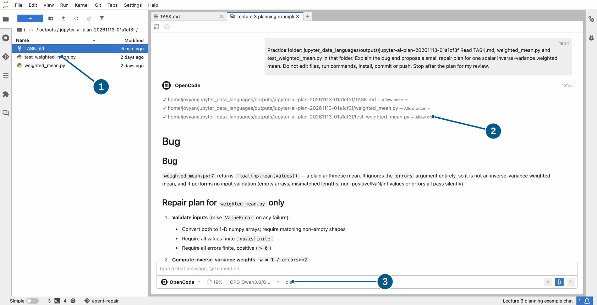

# Choose your coding agent

Prepare **one** approved route before Session 3; pairs can share. Installation,
accounts, provider access and model downloads belong **before class**. Use an
already available model. Without access, use the lesson's saved proposal with a
partner and record that route honestly.

Use the **graphical desktop app or editor panel** for every agent interaction.
The shared terminal commands below prepare files, run tests and inspect Git;
the terminal is not the agent interface for this lesson.

## Prepare the practice workspace

In a CPD JupyterLab **Terminal**, activate the prepared environment:

```bash
source /opt/course/.venv/bin/activate
```

Locally, activate your existing course environment. From the **course root**, run
the same preparation command for every tool:

```bash
python scripts/create_agent_practice.py outputs/agent-practice
```

This prepares `TASK.md`, `weighted_mean.py` and `test_weighted_mean.py`, commits the
starter and creates `agent-repair`. It adds no remote and refuses an existing
destination; choose a fresh name for a repeat. Open the **printed directory** as
the workspace. Use the existing course environment.

## Controls for your tool

Checked **13 November 2026**. Labels and institutional settings vary; compare the
Session 3 screenshots with your actual app. Desktop apps use a local course
checkout unless an approved remote workspace was prepared before class.
Jupyter AI uses the prepared CPD JupyterLab workspace. Opening a model connection
does not transfer files between those machines.

`````{tab-set}
````{tab-item} Codex
:sync: agent-codex

Open the practice folder in VS Code and click **Open Codex Sidebar** (the
Codex icon), or use your prepared Codex desktop project. The lesson screenshot
uses the editor integration. Check **Work locally**, the practice folder and
the existing model before sending the inspection prompt.

Use **Change permissions → Ask for approval** below the composer. In this UI,
that asks about external files and internet access; workspace edits and commands
can still run without a separate prompt. The initial “inspect only” prompt
communicates scope, rather than enforcing a read-only sandbox. Read tool results,
inspect the file diff in the review pane or VS Code Source Control, and compare
against the tests checkpoint. Use **Stop** to interrupt active work.
[Editor integration](https://learn.chatgpt.com/docs/codex/ide),
[review pane](https://learn.chatgpt.com/docs/code-review),
[permissions](https://learn.chatgpt.com/docs/permission-modes).



[Open full-size screenshot](../book/screenshots/codex-editor-plan.svg)

**Check before sending:** **1** names the practice files; **2** shows local work
and approval controls; **3** is the returned plan to review.
````

````{tab-item} Claude Code
:sync: agent-claude

Open the practice folder in VS Code and select the **Claude Code** panel.
Choose an existing model and **Plan** using the permission control beside the
prompt. The screenshots use Claude Code's graphical editor integration.

After plan review, select **Manual** for execution. Read each edit diff or
command request before accepting or rejecting it; existing allow rules affect
which requests appear. Review the proposed file in the editor and use **Yes**
for that one edit, or **No** to correct its scope. Expand tool cards for execution
results and use Source Control for the resulting Git diff. Click stop to
interrupt; reopen the saved session from its history. Plan and Manual
are distinct from enforced shell containment.
[Editor guide](https://code.claude.com/docs/en/vs-code).



[Open full-size screenshot](../book/screenshots/claude-editor-plan.svg)

**Review before editing:** **1** checks the numerical example; **2** lists input
validation; **3** confirms the session stayed in Plan. **No, keep planning** in
the plan-approval dialog keeps that boundary; choose Manual when ready to edit.
````

````{tab-item} Antigravity
:sync: agent-agy

Open the **Antigravity app**. Choose **Create New Project → This Computer →
Add Folder**, select the practice folder and choose **Next**. In that project's
conversation, use the graphical composer's `/plan` action followed by the
inspection prompt. This is a chat action in the desktop app.

Inspect the **Agent permissions preset** beside the model. **Request Review**
asks for command approval; its sandbox behaviour differs from **Default**.
Check the prepared project settings with the instructor. These controls do not
mean every edit has a pre-application approval gate. Review the plan before
proceeding, then open **Overview → Review** or the changed-files card for diffs.
Expand execution details; use **Cancel** to stop before correcting scope.
[Setup](https://antigravity.google/docs/getting-started),
[planning](https://antigravity.google/docs/plan),
[permissions](https://antigravity.google/docs/agent-settings).



[Open full-size screenshot](../book/screenshots/antigravity-desktop-plan.svg)

**Check the project and permissions:** **1** identifies the workspace; **2** is
advice to verify independently; **3** selects **Request Review**.
````

````{tab-item} Cline + Qwen
:sync: agent-cline

Open the practice folder in VS Code. In Cline settings select **OpenAI Compatible**:

| Setting | Course value |
| --- | --- |
| Base URL | `https://icg-cpd-cluster.port.ac.uk/v1` |
| Model ID | `qwen3-8-27b-mtp-ud-q4-k-xl` (CPD Qwen 3.8 27B) |
| Access | Instructor's current access settings; keep any credential out of prompts |



[Open full-size screenshot](../book/screenshots/cline-cpd-settings.svg)

**Configure the actual connection:** **1** selects **OpenAI Compatible**;
**2** is the Base URL field (use the full URL in the table) and masked access
field; **3** selects the course model ID. These settings were used for the
lesson's CPD-backed Cline examples. Provider settings may be shared between
editor profiles; check the selected connection before changing it.

Use the model ID advertised by the course endpoint; the hosted Jupyter AI alias
`cpd/qwen3.8` is a different configuration. Confirm access and capability settings
before class. Start in **Plan**; switch
to **Act** only after review. Keep **Auto Approve** and **YOLO** off. Inspect
proposed diffs and tool results before approving the next action. Use Cline's
cancel control to interrupt; checkpoints help compare/restore edits. Inference
runs on CPD, but files and commands belong
to the machine hosting your VS Code workspace. A laptop client can edit laptop
files. Approvals/checkpoints do not create an OS sandbox.
[Provider](https://docs.cline.bot/provider-config/openai-compatible),
[Plan/Act](https://docs.cline.bot/core-workflows/plan-and-act),
[approvals](https://docs.cline.bot/features/auto-approve).
````

````{tab-item} OpenCode
:sync: agent-opencode

Open **OpenCode Desktop** and select the practice directory in its project/folder
picker. Check the session's directory and prepared provider/model. CPD's Jupyter
configuration does not automatically configure a laptop app.

Use the GUI agent selector's **Plan** option for inspection, then **Build** after
reviewing the plan. Check the instructor's prepared permissions and turn off auto-accept for the
exercise. Where a permission request appears, use **Allow once** for the bounded
action or **Deny** to refuse it. Some configured actions may already be allowed.
Expand tool results and click **Toggle review** for changes; this is review of
the resulting diff, rather than a guaranteed pre-edit gate. Use its stop control to interrupt;
return to the session from the sidebar to continue. Agent modes and permission
prompts do not establish an OS shell sandbox. Match controls to your installed
desktop release.
[OpenCode Desktop](https://dev.opencode.ai/desktop),
[agents](https://opencode.ai/docs/agents),
[permissions](https://opencode.ai/docs/permissions).



[Open full-size screenshot](../book/screenshots/opencode-desktop-plan.svg)

**Check the session:** **1** identifies the project; **2** selects Plan/Build;
**3** opens the review pane. Use your prepared model; this capture shows Big Pickle.
````

````{tab-item} Jupyter AI
:sync: agent-jupyterai

In CPD JupyterLab, open the **Jupyter Chat** sidebar and choose **New chat**.
Select the prepared **OpenCode** persona in the input toolbar. After it connects,
the toolbar shows the CPD Qwen model and session mode; expand **More controls**
if needed. Through ACP it uses **cpd/qwen3.8**: Jupyter AI is the interface,
OpenCode the agent, Qwen the model.

Attach `TASK.md`, `weighted_mean.py` and `test_weighted_mean.py` from the practice
directory, or give their paths relative to the Jupyter server root. Check the
agent's directory and mode/permission controls. Review tool requests: **Allow once**
for a bounded request or **Reject** when scope is unclear. Read each edit diff
and command result. **Stop generating** interrupts the turn; reopen the saved
chat to resume. If only chat is available, request a proposed patch, review and
apply it yourself, and record that fallback.
[Jupyter AI agent chat](https://jupyter-ai.readthedocs.io/en/latest/users/chat/index.html).



[Open full-size screenshot](../book/screenshots/jupyter-ai-plan.svg)

**Check the hosted route:** **1** names the practice files; **2** shows scoped
reads and the plan; **3** identifies OpenCode, CPD Qwen and plan mode.
````
`````

Use the same lesson prompts, phase checkpoints and acceptance criteria whichever
tab you choose. The Git branch and practice folder aid recovery; they are not a
security boundary. A request to “edit only one file” communicates scope without
enforcing it. Keep extra filesystem/network access subject to review; the
approved model connection still needs network access. Run the final tests yourself
in the practice directory using the active course environment.
