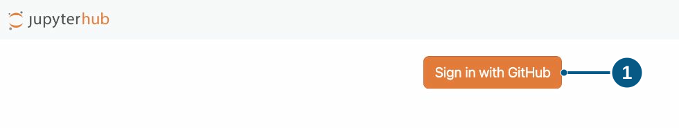
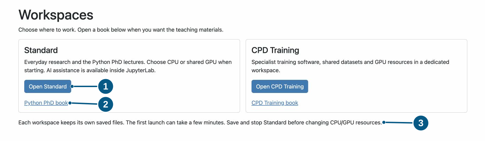
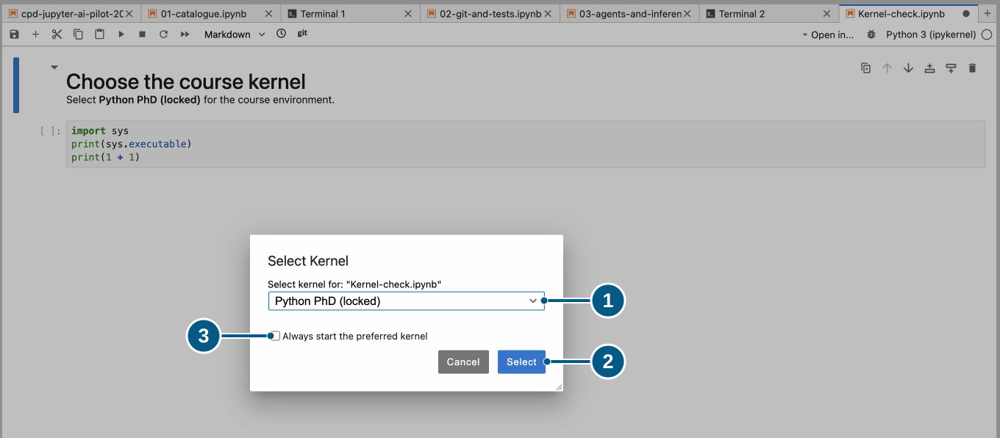

# Before the first session

Allow 10 minutes on CPD or 20–30 minutes for a local installation. Choose **Option A** to work entirely in your browser, or **Option B** to install locally (Python 3.11+ and Git 2.28+; the locked course environment uses Python 3.13). VS Code is optional. See *Environments and kernels: pip, conda and uv* at the start of [Session 1](01-catalogue.ipynb) for how `uv`, `pip` and `conda` relate.

## Option A: Use CPD in your browser (recommended, no local install)

1. Open [the Python PhD book](https://icg-cpd-cluster.port.ac.uk/python-phd/), choose **Connect to JupyterHub**, and authenticate with your enrolled GitHub account (creating a GitHub account alone does not grant access; ask the instructor if access is denied).



**Sign in:** Choose **Sign in with GitHub** (**1**) using your enrolled account. [Open full-size screenshot](../book/screenshots/jupyterhub-signin.svg)

2. On **Workspaces**, choose **Open Standard** for full JupyterLab or **Python PhD book** for the interactive book; ignore the separate `CPD Training` card. If prompted for server options, select **Standard (CPU)** — no GPU is needed, and first startup takes a couple of minutes.



**Workspaces:** Choose **Open Standard** (**1**) for JupyterLab or **Python PhD book** (**2**) for the course pages (**3** notes separate workspace storage). [Open full-size screenshot](../book/screenshots/jupyterhub-workspaces.svg)

3. On any notebook page in the book, click the **`⏻` Start compute** toolbar icon to run cells inline from top to bottom, or open the connection menu and choose **Open this notebook in CPD JupyterHub** for JupyterLab editing, files, the pre-enabled **Git** sidebar, and terminals.

4. In CPD JupyterLab, click the kernel indicator at the notebook's top right, choose **Python PhD (locked)** under **Start python Kernel**, and click **Select** (start a fresh kernel rather than attaching to another notebook's session).



**Select kernel:** Pick **Python PhD (locked)** (**1**) and click **Select** (**2**), leaving **Always start the preferred kernel** (**3**) unchecked. [Open full-size screenshot](../book/screenshots/jupyterlab-kernel-choice.svg)

5. In a notebook cell, `import sys; print(sys.executable)` should print `/opt/course/.venv/bin/python`. In **each new CPD JupyterLab terminal**, activate that same environment before running `python` or `pytest`:

```bash
source /opt/course/.venv/bin/activate
```

Disconnecting the book leaves your server running; stop your Standard server via the JupyterHub control panel when finished (your files are kept).

## Option B: Install locally instead

Clone the [`codex/phd-python-2026` course branch](https://github.com/xangma/jupyter_data_languages/tree/codex/phd-python-2026) explicitly (the default `master` branch is an older archive) and enter the repository root:

```bash
git clone --branch codex/phd-python-2026 https://github.com/xangma/jupyter_data_languages.git
cd jupyter_data_languages
```

### Option B1: Reproducible setup with uv

Install [uv](https://docs.astral.sh/uv/getting-started/installation/) and [Git](https://git-scm.com/downloads), then run:

```bash
uv sync --frozen --python 3.13 --extra teaching
uv run --frozen --extra teaching python -m ipykernel install --user --name python-phd --display-name "Python PhD (locked)"
uv run --frozen --extra teaching python scripts/check_setup.py
uv run --frozen --extra teaching jupyter lab
```

`uv sync` creates a local `.venv/` with the exact package versions pinned in `uv.lock`, while `ipykernel install` registers that `.venv` interpreter in Jupyter as **Python PhD (locked)**. After installation you can pass `--offline` to `uv run`, and in each new terminal for Sessions 2 and 3 activate `.venv` from the course root (`source .venv/bin/activate` on macOS/Linux, `source .venv/Scripts/activate` in Windows Git Bash, or `.venv\Scripts\Activate.ps1` in PowerShell).

### Option B2: Standard Python venv

Create and activate a virtual environment (`python -m venv .venv`, followed by `source .venv/bin/activate` on macOS/Linux, `source .venv/Scripts/activate` in Windows Git Bash, or `.venv\Scripts\Activate.ps1` in PowerShell), then install the editable package and kernel:

```bash
python -m pip install -e ".[teaching]"
python -m ipykernel install --user --name python-phd --display-name "Python PhD (locked)"
python scripts/check_setup.py
python -m jupyter lab
```

Select **Python PhD (locked)** in JupyterLab (or choose `.venv` in VS Code's **Select Kernel** menu with the Python and Jupyter extensions). On Windows, use **Git Bash** for shell commands in Sessions 2 and 3.

## Readiness check

1. **Python and Git:** Run `python scripts/check_setup.py` and `python -m pytest -q` in your active course terminal. Confirm `395 usable rows out of 400`, `Setup OK`, and passing reference tests (`exercises/test_weighted_mean.py` intentionally fails until you repair a separate practice copy in Session 3 — leave `exercises/` untouched).
2. **Coding agent (before Session 3):** Complete [Choose your coding agent](agent-tools.md) to configure `Jupyter AI on CPD`, `Cline + CPD Qwen`, `Claude Code`, or the manual pair option and create your practice folder. Tell the instructor before class if any step is blocked.
